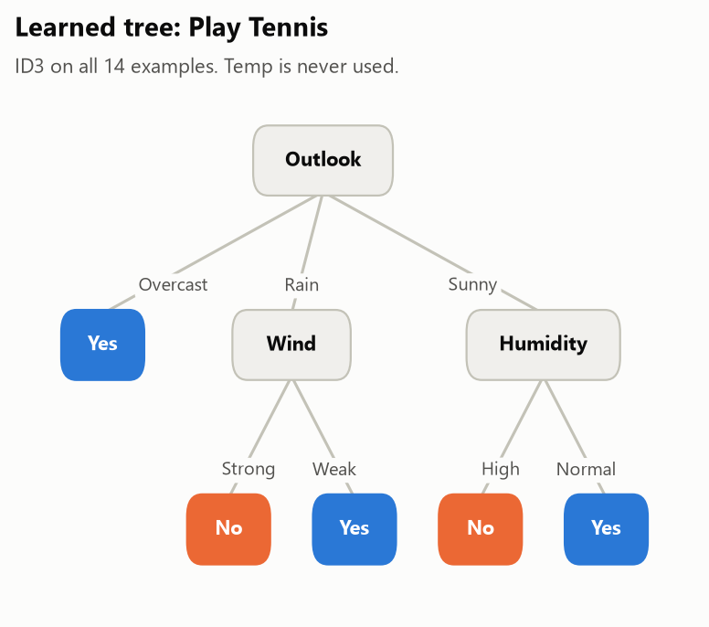
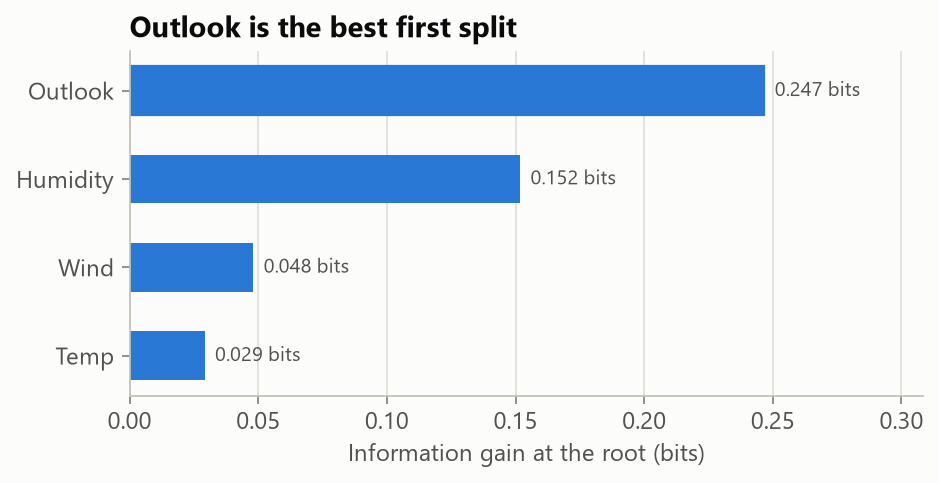
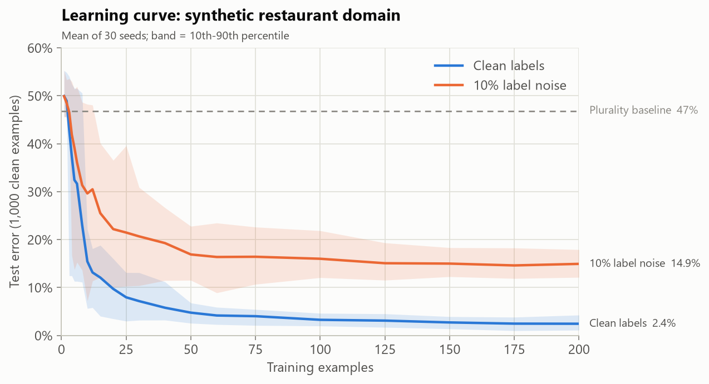
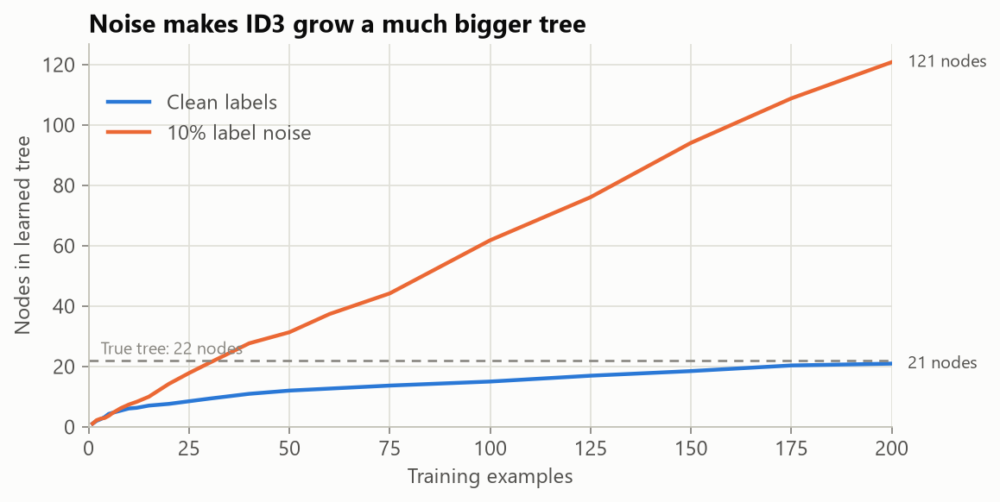
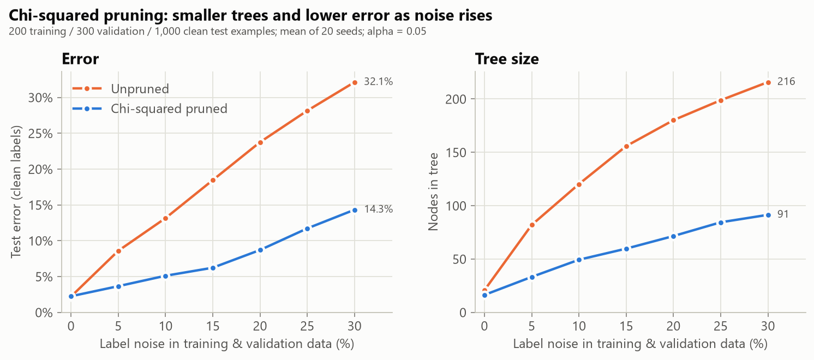
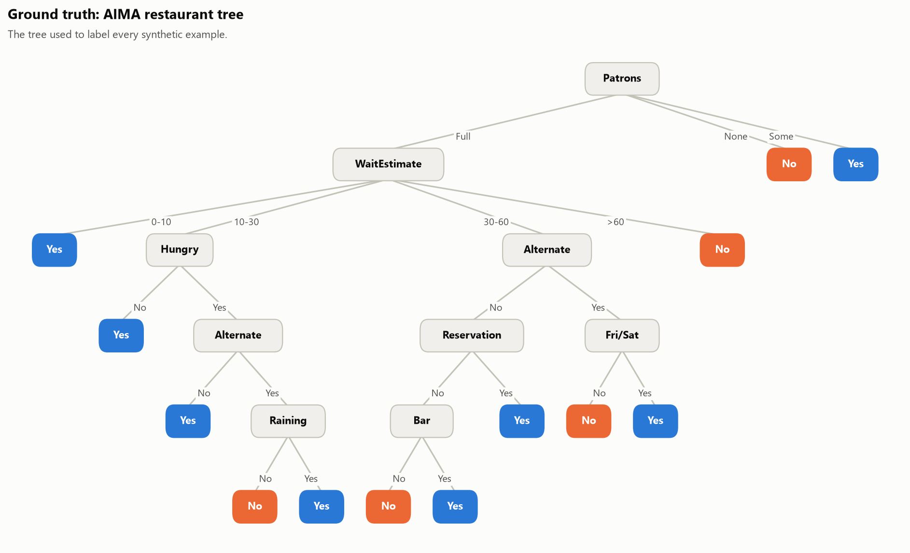
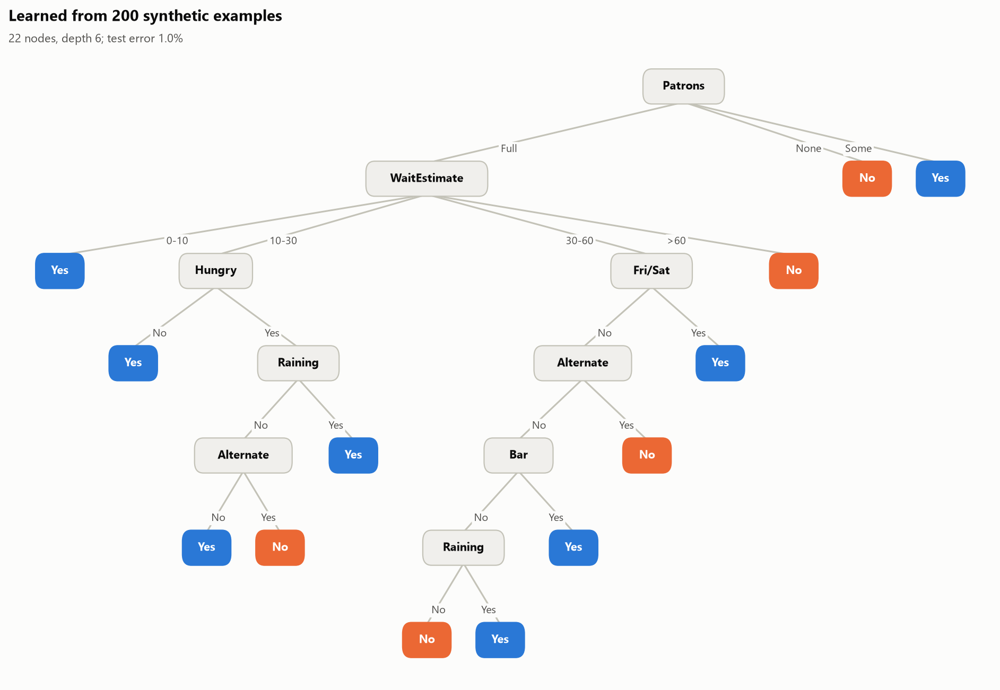
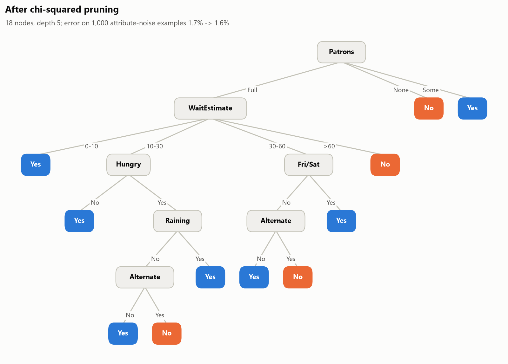

# Decision Trees from Scratch: ID3 + Chi-Squared Pruning

[](https://github.com/HAMZl/decision_trees/actions/workflows/tests.yml)

A pure-Python decision tree learner (no scikit-learn) that grows trees with
**information gain (ID3)** and prunes them with **chi-squared significance
tests**. It started as an Artificial Intelligence course project based on
Russell & Norvig's *Artificial Intelligence: A Modern Approach* (AIMA), built on
the [aima-python](https://github.com/aimacode/aima-python) `learning.py` code,
then extended with proper evaluation, bug fixes, tests and
the experiments below.

<p align="center">
  
</p>

## Highlights

| | Result |
|---|---|
| Play Tennis, leave-one-out CV | **21.4% error**, against 35.7% for always predicting the majority class |
| Synthetic restaurant, 200 clean examples | **2.4% test error** (mean of 30 seeds); the learned tree is almost exactly the size of the true one |
| Restaurant with 10% label noise | Unpruned ID3 grows **121 nodes** (true tree: 22) and plateaus at 14.9% error |
| Chi-squared pruning at 10% noise | **13.2% → 5.1% test error** and **120 → 49 nodes** |

All numbers come from [`results/metrics.json`](results/metrics.json), which
`python experiments.py` regenerates along with every figure in this README.

## Quick start

```bash
git clone https://github.com/HAMZl/decision_trees.git
cd decision_trees
python -m venv .venv && source .venv/bin/activate   # Windows: .venv\Scripts\activate
pip install -r requirements.txt

python decision_tree.py  # text report for each task
python experiments.py     # regenerate images/ and results/metrics.json (~1 min)
pytest -q                 # 11 unit tests
```

## How it works

**Growing (ID3).** At each node, pick the attribute whose split gives the
largest drop in entropy:

$$\text{Gain}(A) = H(S) - \sum_{v \in \text{values}(A)} \frac{|S_v|}{|S|} H(S_v), \qquad H(S) = -\sum_c p_c \log_2 p_c$$

Recursion stops when a node is pure or no attributes are left. A branch with
no training examples predicts its parent's majority class.

**Pruning (chi-squared).** Run a separate validation set through the tree.
For every fork whose children are all leaves, compare each child's observed
Yes/No counts with the counts you would expect if the split were irrelevant:

$$\Delta = \sum_{k} \frac{(p_k - \hat p_k)^2}{\hat p_k} + \frac{(n_k - \hat n_k)^2}{\hat n_k}, \qquad \hat p_k = p \cdot \frac{p_k + n_k}{p + n}$$

Under the null hypothesis, Δ follows a χ² distribution with (non-empty
branches − 1) degrees of freedom. If *p* > 0.05, the fork becomes a
majority-class leaf. Passes repeat bottom-up until nothing changes.

## Results

### 1. Play Tennis: does the learner recover the textbook tree?

Yes. Outlook has the highest information gain (0.247 bits, the classic
Quinlan value), and the learned tree never uses *Temp*.

<p align="center"></p>

With only 14 rows, a 3-row hold-out set says very little. Its error is 0%,
but one wrong answer would make it 33%. Leave-one-out cross-validation is the
more honest estimate: **21.4%** error, against 35.7% for the plurality
baseline.

### 2. Learning curve: how much data does ID3 need?

The training data is labelled by the AIMA restaurant tree (below). Each tree
is tested on 1,000 fresh, noise-free examples.

<p align="center"></p>

- **Clean labels:** error falls below 5% after about 50 examples and reaches 2.4% at 200.
- **10% label noise:** error plateaus near 15%. More data doesn't help, because the tree keeps memorising the noise:

<p align="center"></p>

That linear growth is classic overfitting, and it is the problem pruning solves.

### 3. Chi-squared pruning vs label noise

Each run trains on 200 noisy examples, prunes using 300 separate noisy
validation examples, and evaluates on 1,000 clean test examples, so the
pruning step never sees the test set.

<p align="center"></p>

| Label noise | Error, unpruned | Error, pruned | Nodes, unpruned | Nodes, pruned |
|---:|---:|---:|---:|---:|
| 0% | 2.2% | 2.3% | 20.7 | 16.3 |
| 10% | 13.2% | **5.1%** | 120.2 | **49.3** |
| 20% | 23.7% | **8.7%** | 180.1 | **71.5** |
| 30% | 32.1% | **14.3%** | 215.8 | **91.4** |

On clean data, pruning costs essentially nothing. Under noise, it more than
halves the error.

### 4. The restaurant pipeline, visualised

<details>
<summary><b>Ground-truth tree, learned tree, and pruned tree</b> (click to expand)</summary>

The tree used to generate the synthetic data (AIMA Figure 19.3):



What ID3 learns from 200 synthetic examples. It reaches 1.0% test
error, but notice the different structure under `30-60` and `10-30`:



After pruning with a 1,000-example attribute-noise set, the
deep `Bar → Raining` chain disappears:



</details>

## Fixes to the original code

While writing this up, I found and fixed several bugs that made the original
numbers misleading:

| Issue | Effect | Fix |
|---|---|---|
| `test_tennis_tree` learnt the tree on **all** data, then split off a test set | Test examples were already in the training set (data leakage) | Split first, train only on the training part; added leave-one-out CV |
| `SyntheticRestaurantTest` never applied the true tree | Test labels were **random coin flips** | Label with `waiting_decision_tree`; added an optional `noise` parameter |
| Its noise branch used `rand >= 1.1` and `==` instead of `=` | Dead code | Replaced with a working `noise` probability |
| `evaluate` measured error **before** pruning | The reported "pruned error" was the unpruned tree's | Error is now measured after pruning |
| `prune_tree` looped on the last fork's p-value | It could stop while prunable forks remained | Repeat passes until one prunes nothing |
| `clear_counts` skipped the root | Root counts piled up across passes | Clear every node |
| χ² degrees of freedom = number of branches | Test too lenient (over-pruned) | Use non-empty branches − 1 (AIMA §19.3.4) |
| Newly pruned leaves had zero counts | A parent couldn't be tested in the same pass | Pruned leaves inherit the fork's counts |
| CSV paths relative to the working directory | Crashed outside the repo folder | Resolved relative to the module |

Every task function keeps its original name and signature.

## Project structure

```
decision_tree.py      Learner, pruning, data generators, tasks 1-4
experiments.py        Every figure + results/metrics.json (seeded, reproducible)
utils.py              AIMA helper functions
tennis.csv            Quinlan's 14-example Play Tennis data
restaurant1.csv       AIMA restaurant examples (Figure 19.2)
images/               Generated figures
results/metrics.json  Generated numbers quoted above
tests/                pytest suite
```

## References

- S. Russell & P. Norvig, *Artificial Intelligence: A Modern Approach*, 4th ed., §19.3 (decision trees, χ² pruning).
- J. R. Quinlan, "Induction of Decision Trees", *Machine Learning* 1, 1986.
- [aimacode/aima-python](https://github.com/aimacode/aima-python), source of the base `DataSet`/learner code and `utils.py`.
